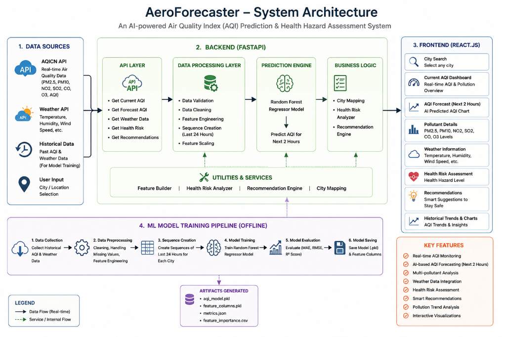
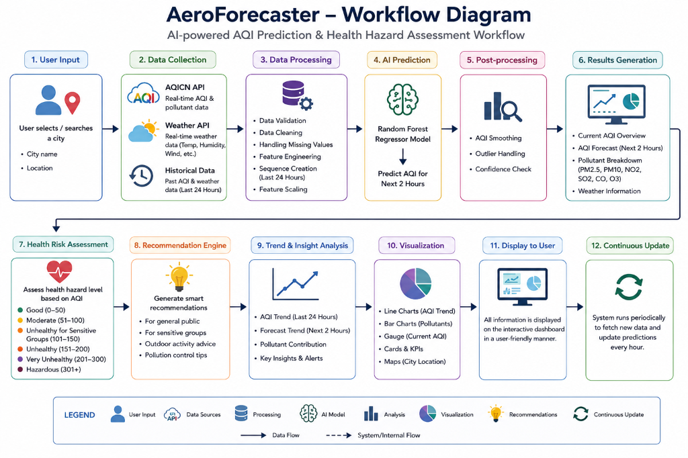

# 🌍 AeroForecaster Backend – AI-Powered AQI Forecasting Service

<p align="center">
The machine learning pipeline and REST API server for AeroForecaster. Powered by FastAPI and Scikit-learn to forecast future AQI levels, analyze health risk assessments, and generate recommendations.
</p>

---

## 🏗️ System Architecture

<p align="center">
  
</p>

---

## 🔄 Workflow Diagram

<p align="center">
  
</p>

---

## 🤖 Machine Learning Pipeline

### Model
* **Random Forest Regressor** (trained on historical pollutant and weather data)

### Input Features

#### Air Pollutants
* PM2.5
* PM10
* NO₂
* SO₂
* CO
* O₃

#### Weather Parameters
* Temperature
* Humidity
* Wind Speed

#### Historical Features
* Previous 24-hour AQI values
* Lag Features
* Rolling Mean
* Rolling Standard Deviation
* Time Features
* Sequence Features

### Output
* Predicted AQI (Next 2 Hours)
* Health Hazard Level
* Pollution Trend
* Personalized Recommendations

---

## 🛠️ Backend Tech Stack

* **Web Framework:** FastAPI & Uvicorn
* **Machine Learning:** Scikit-learn (Random Forest Regressor), Pandas, NumPy, Joblib
* **APIs Integrated:** AQICN API, OpenWeather API

---

## 📂 Backend Directory Structure

```text
backend/
├── models/             # Contains the trained Random Forest and feature assets
├── services/           # Business logic, predictions, and health risk analyser
├── utils/              # Data parsing and feature builder utilities
├── main.py             # FastAPI entry point
└── requirements.txt    # Python package dependencies
```

---

## 🚀 Installation & Run Instructions

Ensure you have Python 3.9+ installed.

```bash
# Navigate to the backend directory
cd backend

# Create a virtual environment and activate it
python -m venv venv
# On Windows:
venv\Scripts\activate
# On macOS/Linux:
source venv/bin/activate

# Install dependencies
pip install -r requirements.txt

# Run the FastAPI server
uvicorn main:app --reload
```

---

## 📊 Model Workflow

1. User selects a city.
2. The system retrieves real-time AQI and weather data.
3. Data is cleaned and transformed using the feature engineering pipeline.
4. Historical features and sequence data are generated.
5. The Random Forest model predicts AQI for the next 2 hours.
6. The predicted AQI is classified into health risk categories.
7. Personalized health recommendations are generated.
8. Interactive charts and analytics are returned via FastAPI endpoints.

---

## 📈 Outputs

The backend API returns JSON data containing:
* 🌍 **Current AQI**
* 🤖 **Predicted AQI** (Next 2 Hours)
* 🌦 **Weather Information**
* 🫁 **Pollutant Concentrations**
* 🚨 **Health Risk Assessment**
* 💡 **Smart Recommendations**
* 📊 **Historical AQI Trends**

---

## 👩💻 Author

**Poulami Kundu**
B.Tech Computer Science & Engineering
AI • Machine Learning • Full-Stack Development
